<div align="center">



# AdulaJS

**The TypeScript framework for business applications, from one command to production.**

Declare a resource once and get its table, permissions, screens, API and tests.
Arabic-first, permission-safe and built to be extended by AI coding agents.

[](https://www.npmjs.com/package/adula)
[](https://github.com/adulash/adulajs/actions/workflows/ci.yml)
[](LICENSE)


```sh
npx create-adula-app@latest my-app
```

[Quick start](#quick-start) · [Features](#whats-in-the-box) · [AI agents](#built-for-ai-coding-agents) · [Built with](#built-with) · [Docs](docs/README.md)

</div>

> [!NOTE]
> **AdulaJS 2.0** is the 1.x framework under its new name ([ADR 039](docs/decisions/039-rename-to-adulajs.md)).
> Applications on 1.x upgrade with `npx create-adula-app@latest upgrade`; see the [2.0 upgrade guide](docs/upgrade-2.0.md).

---

## Why AdulaJS

Most business systems repeat the same work: tables, lists, forms, roles, approvals,
notifications, imports, printing, audit history and backups. AdulaJS is a TypeScript
framework built for business applications: it turns that work into declarations and
services, so your team (or your agent) writes only what is specific to the business.

- **One declaration, a whole module.** `defineResource` describes fields, forms, lists,
  actions and scope. AdulaJS derives the table, validation, serialization, HTTP routes,
  screens, OpenAPI description and contract tests.
- **Permissions you can trust.** One CASL rule set is evaluated in the browser and in the
  service layer, and compiled to SQL, together with an organizational tree. Every feature
  goes through the same access check, so no screen, API call, import or webhook reaches a
  record its user could not open.
- **An Arabic-first interface you own.** RTL shadcn/ui components are copied into your
  project, not hidden inside a package. Upgrades never overwrite a component you changed,
  and `adula:doctor` tells you what to review.
- **Ready for AI agents.** Every application ships managed agent rules, a capability
  catalog, design and review skills and MCP tools, so coding agents extend it inside its
  boundaries instead of around them.
- **Operations included.** Offsite backups with restore verification, attachments on disk
  or S3, a health doctor, additive migrations and a tested upgrade path.

## Quick start

```sh
npx create-adula-app@latest my-app
```

The creator starts from an empty folder and does the rest. It installs AdulaJS and
its stack, starts PostgreSQL 17 and Redis 7 in Docker (or uses your existing services),
creates the development and test databases, runs migrations, creates the administrator,
asks for your company identity and builds the application.

```sh
cd my-app
npm run dev
```

Requirements: Node.js 24+, npm, and Docker with Compose for the default mode. The
terminal speaks English; the application speaks Arabic. The
[installation guide](docs/installation.md) covers existing services and offline archives.

## Define a resource, get a working module

```sh
node ace adula:resource customers --module=sales
```

This writes the resource, model, validator, migration, factory and an HTTP contract test.
You describe the business in the resource:

```ts
import { defineResource } from 'adula'
import Model from '#modules/sales/models/customers'
import { validator } from '#modules/sales/validators/customers'

export default defineResource({
  name: 'customers',
  label: { ar: 'العملاء', en: 'Customers' },
  fields: {
    name: {
      type: 'string',
      label: { ar: 'اسم العميل', en: 'Name' },
      required: true,
      unique: true,
      searchable: true,
    },
    email: { type: 'string', label: { ar: 'البريد الإلكتروني', en: 'Email' } },
  },
  list: ['name', 'email'],
  form: ['name', 'email'],
  show: ['name', 'email'],
  actions: ['view', 'create', 'update', 'delete'],
  model: Model,
  validator,
})
```

From this declaration and the user's permissions you get the list page (search, filters,
sorting, saved views), forms in dialogs, a record page with comments and change history,
token-authenticated endpoints under `/api/v1` and their OpenAPI description.

## What's in the box

| Area | What you get |
|---|---|
| **Resources** | Typed fields including money (integer minor units) and dates, inline child rows, unique fields, versioned updates (stale writes return 409), soft delete, generated screens |
| **Authorization** | Roles and rules in the database, field-level permissions, organizational scope, CASL compiled to SQL, administration screens for users, roles and units |
| **Documents and workflows** | Submit, cancel and amend-by-copy; versioned workflows as code with `condition`, `approval`, `update`, `notify`, `delay`, `http` and `end` steps |
| **Collaboration** | Comments with mentions, followers, tags, field-level change history, assignments and a "My tasks" inbox with in-place approvals |
| **Notifications** | Editable message templates, e-mail delivery and a realtime bell over SSE |
| **Integrations** | Signed outgoing webhooks with retries, verified inbound webhooks, personal API tokens, OpenAPI |
| **Data** | CSV import through the same permission checks; RTL A4 printing with optional PDF |
| **Files and backups** | Attachments on local disk or S3, offsite database and file backups, restore verification |
| **Operations** | `adula:doctor` for installation, migrations, backups, the event outbox, UI drift and agent assets; a worker and a scheduler for background work |
| **Agents** | Managed `AGENTS.md`, the `adula:capabilities` catalog, idea-review, design and five reviewer skills, MCP resource tools |

Details and examples are in the [business features guide](docs/business-features.md).

## Built for AI coding agents

AdulaJS assumes part of your code will be written by agents, and gives them rails:

- **Managed rules.** `AGENTS.md` carries a managed block of rules (authorization,
  serialization, boundaries, design) that `adula:install` keeps current without touching
  your own rules.
- **Know before building.** `node ace adula:capabilities` prints what AdulaJS and your
  registry already provide, so an agent reuses a service instead of re-implementing it.
- **Skills.** Idea review turns a request into existing resources and extension points
  before any code is written. A business frontend-design skill and five on-demand
  reviewers (module, security, schema, UI and performance) ship with every application.
- **Gaps, not workarounds.** When something is missing, the agent records it in `GAPS.md`,
  and `node ace adula:gaps report` prepares a prefilled issue. Patching installed packages
  is blocked by lint and reported by doctor.

## Built with

AdulaJS composes proven open-source tools instead of reinventing them:

| Layer | Technology |
|---|---|
| **Language** | [TypeScript](https://www.typescriptlang.org) 6, strict, on [Node.js](https://nodejs.org) 24+ |
| **Server** | [AdonisJS](https://adonisjs.com) 7 with Lucid ORM and VineJS validation |
| **Database** | [PostgreSQL](https://www.postgresql.org) 17, with [Redis](https://redis.io) 7 |
| **Authorization** | [CASL](https://casl.js.org) 7, compiled to SQL |
| **Frontend** | [React](https://react.dev) 19 with [Inertia](https://inertiajs.com) 3, built by [Vite](https://vite.dev) |
| **Interface** | [shadcn/ui](https://ui.shadcn.com) on [Radix UI](https://www.radix-ui.com), [Tailwind CSS](https://tailwindcss.com) 4 and IBM Plex Sans Arabic |

## Packages

| Package | Role |
|---|---|
| [`adula`](packages/adula) | The core: resource engine, CASL/SQL authorization, organizational scope, services, additive migrations and Ace commands |
| [`@adula/ui`](packages/ui) | Arabic RTL shadcn/ui registry: 25 primitives and nine resource components copied into your project |
| [`create-adula-app`](packages/create-adula-app) | Creates a complete application in one command, and upgrades 1.x applications |

The backend updates as a package. Copied UI, pages, domain modules and branding belong to
your application.

## Status

The 1.0 scope was accepted by the owner after staged acceptance with dated evidence
([release readiness](docs/release-readiness.json)). Every change runs, in CI, a genuine
upgrade from the previously published version, an independent consumer built from the
official AdonisJS starter, and the creator from an empty directory through a real
administrator login in a browser.

Known limits are tracked openly in [GAPS.md](GAPS.md). Two-factor authentication and the
human review of impersonation are planned for a later major release, and import is CSV
only for now.

## Documentation

- [Documentation map](docs/README.md)
- [Installation](docs/installation.md) and [development](docs/development.md)
- [Business features](docs/business-features.md)
- [Upgrading a 1.x application to 2.0](docs/upgrade-2.0.md)
- [Architecture decisions](docs/decisions/)
- [Changelog](CHANGELOG.md)

## Contributing

Issues use two forms: a **gap** (a capability AdulaJS lacks) or a **bug**. Reproduce the
problem on a new application from `npx create-adula-app`, not on your own project, and
describe the framework rather than your business. Development setup, tests and the
release process are in [docs/development.md](docs/development.md) and
[docs/releasing.md](docs/releasing.md).

## License

[MIT](LICENSE)
